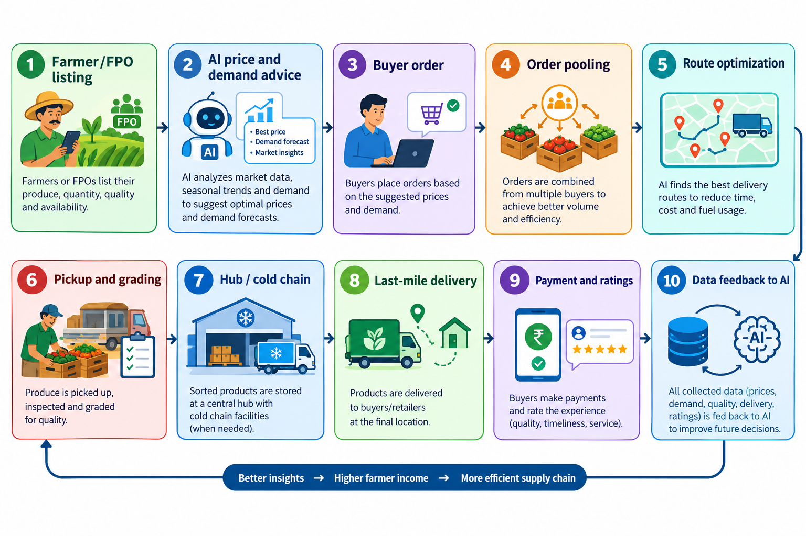

# Smart India Hackathon Workshop
# Date:
## Reference Number:
## Name:

## Problem Title
SIH 26033: Multiple intermediaries reduce farmers earnings and increase consumer prices.

## Problem Creater's Organization
Ministry of Consumer Affairs, Food & Public Distribution

## Theme
Agriculture, FoodTech & Rural Development

## Problem Description
Expected Solution: Create a digital marketplace that:

• Connects farmers/FPOs directly with consumers and bulk buyers.
• Provides logistics support.
• Uses AI for demand forecasting and route optimization.

Benefits:

• Better prices for farmers.
• Lower prices for consumers.
• Reduced supply chain inefficiencies.

## Proposed Solution
1. Proposed Solution

Detailed explanation
UzhavanLink is a mobile-first (Android, PWA, and WhatsApp/IVR for low-literacy users) marketplace with three user groups:

Sellers: farmers and FPOs list produce with quantity, grade, photos, and harvest date, in regional languages with voice input.
Buyers: consumers (weekly subscription baskets), bulk buyers (restaurants, retailers, hostels, processors), and government institutions (PDS, mid-day meal, hospitals).
Logistics partners: local aggregation hubs, cold-chain and transport operators, and last-mile riders.

Core modules:

Direct listing and order matching: the farmer sets a floor price, the platform shows a live mandi benchmark (Agmarknet/e-NAM), and buyers order at a transparent price.
Pooled logistics: orders from several farmers in one cluster are combined into shared trips via village collection points, so small farmers get logistics costs of large sellers.
AI demand forecasting: predicts demand and price by crop, region, and week, and advises farmers what and when to sell or sow.
AI route optimization: vehicle routing that groups pickups and deliveries, minimizing distance, spoilage time, and cost.
Trust layer: quality grading with photo and AI checks, ratings, escrow payments, and instant UPI payout to the farmer within 24 hours.
Price transparency dashboard: shows farmer price, logistics cost, platform fee, and consumer price for every order.

How it addresses the problem

Removes layers of intermediaries (commission agents, wholesalers, sub-wholesalers, retailers) by connecting producers to buyers in one step.
Replaces their margin with a small, visible platform and logistics fee, so farmers get more and consumers pay less.
Forecasting cuts the glut-and-shortage cycles that cause price crashes and spikes.
Pooled, optimized logistics lowers cost per kg and spoilage, which are the main reasons farmers rely on middlemen.

Innovation and uniqueness

Logistics-first design: pooled, AI-routed trips for small farmers, rather than only a listing app.
Forecast-to-farmer loop: farmers get sowing and selling advice, and buyers get supply forecasts. Aggregate demand can be committed in advance, like a pre-booked forward contract.
Price breakup transparency on every order, which builds trust and also helps the Department of Consumer Affairs monitor prices.
Inclusive access: voice and vernacular interfaces, WhatsApp/IVR ordering, and FPO-managed collection points for farmers without smartphones.
Interoperable: built on open rails (ONDC, UPI, Agristack, e-NAM data) rather than as a closed silo.

## Technical Approach
Technologies

Mobile and web - Flutter (Android) plus React PWA; multilingual UI, voice input (Bhashini APIs)
Backend -	Python (FastAPI) or Node.js microservices, REST/GraphQL
Database -	PostgreSQL + PostGIS (geo queries), Redis (cache), object storage for images
AI/ML -	Demand and price forecasting: Prophet/LSTM/XGBoost on Agmarknet, weather (IMD), and sales data. Quality grading: CNN (MobileNet/EfficientNet). Routing: Google OR-Tools (capacitated VRP with time windows)
Maps and tracking	- OpenStreetMap/Google Maps APIs, GPS tracking, live ETA
Payments -	UPI, escrow, auto-settlement to farmer bank accounts
Integrations -	Agmarknet/e-NAM prices, ONDC, Agristack, IMD weather, SMS/WhatsApp/IVR gateway
Cloud and security -	Containerized (Docker/Kubernetes), Aadhaar-based or OTP KYC, role-based access, encryption

Methodology and process

Onboard: farmer or FPO registers (KYC, location, crops) through app, IVR, or an FPO agent.
List: the farmer posts expected harvest, quantity, and floor price; the AI suggests the best price window.
Order: buyers browse and place orders; subscriptions and bulk contracts are supported.
Match and pool: the system groups orders by region and delivery slot.
Route: the optimizer assigns pickups to a village collection point, then a hub, then delivery.
Quality check: photo-based grading at pickup, with a dispute window.
Deliver and pay: the buyer confirms delivery and the farmer is paid instantly via UPI.
Learn: sales and feedback data retrain the forecasting and routing models.

## Feasibility and Viability
Feasibility

Technical: all components (marketplace, forecasting, VRP routing, UPI) use mature, proven tools, and public price data is available.
Operational: FPOs (government is promoting 10,000 new FPOs) already aggregate farmers, giving natural collection points.
Economic: revenue from a small platform commission (about 2–4%), logistics margin, subscription baskets, and premium analytics for bulk buyers. Savings from removing middlemen and cutting spoilage fund the model.
Policy fit: aligns with e-NAM, ONDC, and Agristack, and supports Digital India and doubling farmers’ income goals.

Challenges and risks

Risk	- Strategy
Low digital literacy and smartphone access -	Vernacular voice UI, IVR/WhatsApp ordering, FPO and village-level entrepreneur agents
Perishability and cold-chain cost -	Hub-based aggregation, same-day delivery for leafy items, phased cold storage via partners and PM-KUSUM/AIF-type schemes
Quality inconsistency -	Standard grading, AI photo checks, ratings, buyer dispute window
Chicken-and-egg problem (buyers vs sellers) -	Launch in one district cluster, start with institutional and bulk anchor buyers, then add consumers
Resistance from existing mandi traders -	Offer traders a role as logistics or hub partners; comply with APMC rules and e-NAM linkage
Payment trust and delays -	Escrow plus instant UPI settlement
Price manipulation or side-selling -	Forward contracts with penalties, reputation scores
Data quality for AI -	Start with rule-based benchmarks, improve with collected data, keep a human fallback

## Impact and Benefits
Impact on target audience

Farmers/FPOs: higher realized price (a larger share of the consumer rupee), faster payment, less distress selling, and better planning with forecasts.
Consumers: fresher produce at lower or stable prices, with price transparency.
Bulk and institutional buyers: reliable supply, quality assurance, and contract pricing.
Government: real-time price and supply visibility for inflation monitoring and policy.
Rural youth and local transporters: new jobs as agents, drivers, graders, and hub operators.

Benefits

Economic: fewer middlemen margins, lower spoilage, and less price volatility; more income for farmers and lower prices for consumers.
Social: financial inclusion through digital payments, empowerment of small and women farmers via FPOs, and rural employment.
Environmental: pooled and optimized routes cut fuel use and emissions; lower food waste means less wasted water, land, and inputs.
System efficiency: a data-driven supply chain with better matching of supply and demand.

Suggested KPIs to show on the slide: farmer price uplift (%), consumer price reduction (%), post-harvest loss reduction (%), cost per kg of logistics, payment turnaround time, and number of farmers onboarded.

## Research and References
e-NAM (National Agriculture Market): https://enam.gov.in
Agmarknet (Directorate of Marketing & Inspection, mandi price data): https://agmarknet.gov.in
ONDC (Open Network for Digital Commerce): https://ondc.org
Department of Consumer Affairs price monitoring: https://consumeraffairs.nic.in
Department of Agriculture and Farmers Welfare, FPO scheme (10,000 FPOs): https://agricoop.gov.in
Bhashini (Indian-language AI APIs): https://bhashini.gov.in
Google OR-Tools (vehicle routing): https://developers.google.com/optimization/routing
ICRIER / Ashok Gulati et al., research on farmers’ share in the consumer rupee for tomato, onion, and potato (search “ICRIER farmers’ share consumer rupee TOP value chain”)
Report of the Committee on Doubling Farmers’ Income (Dr. Ashok Dalwai), Government of India
NABARD and ICAR-CIPHET studies on post-harvest losses of fruits and vegetables
